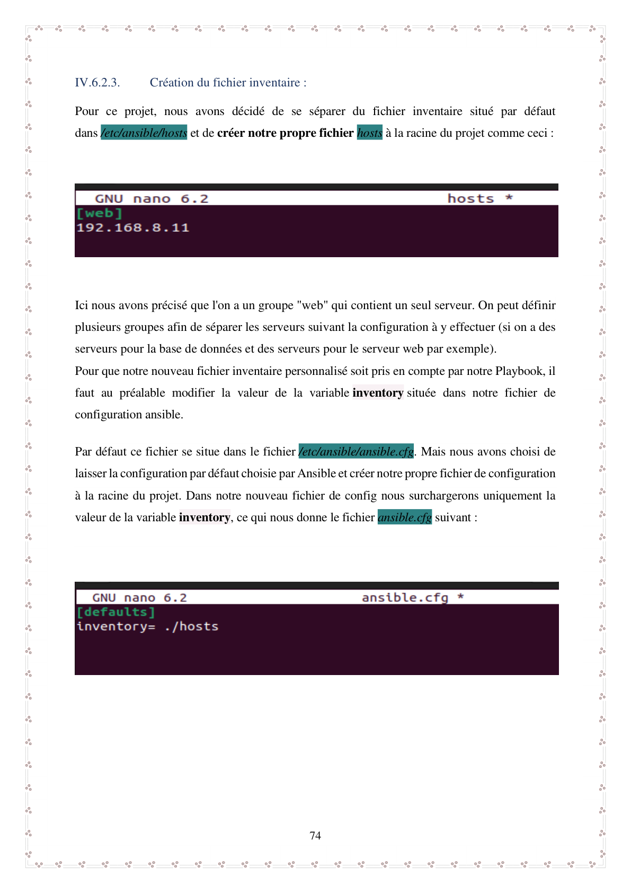
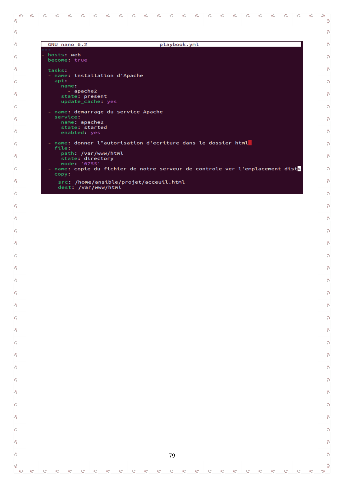
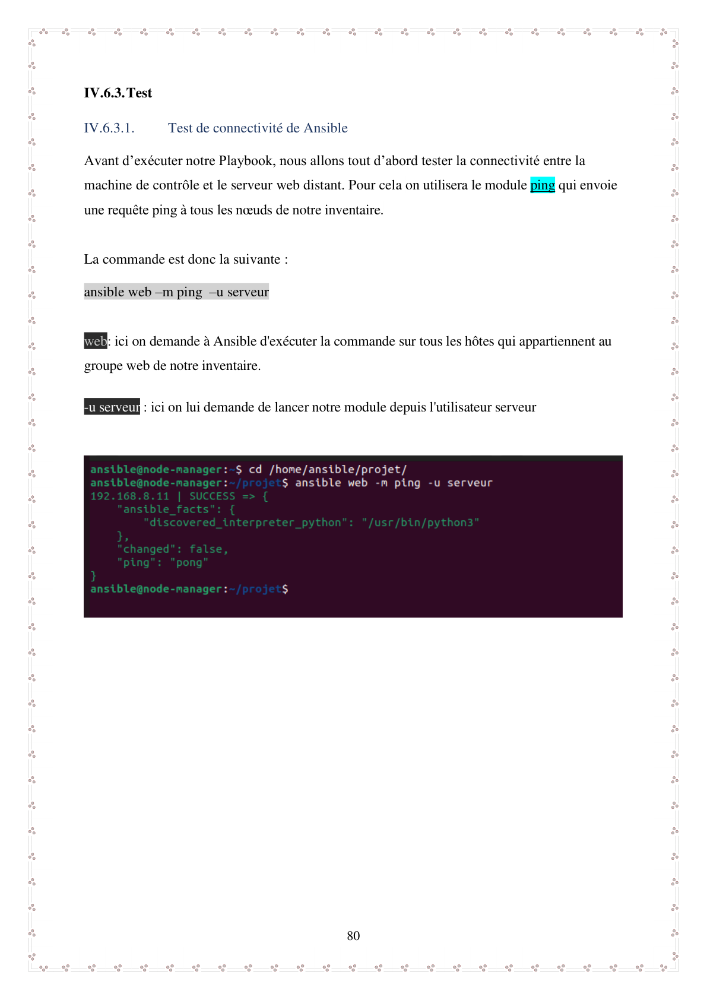
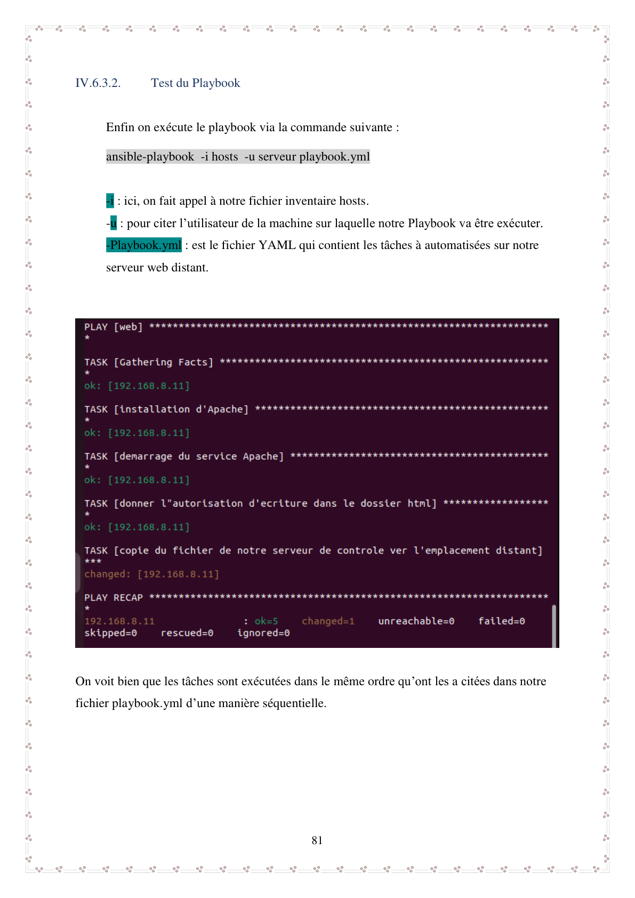
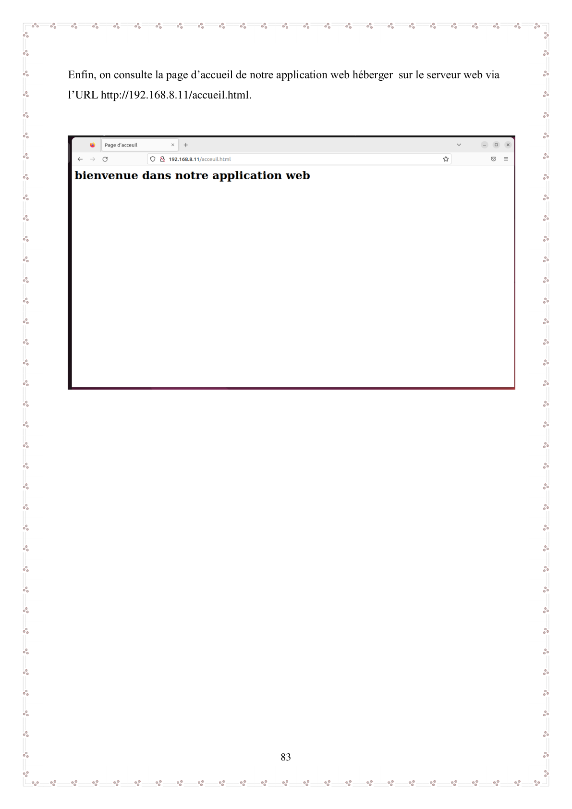

# Automatisation du déploiement d'applications avec Ansible

## Présentation du projet

Ce projet de fin d'études de Master en informatique a été réalisé en 2021-2022 à l'Université Mouloud Mammeri de Tizi-Ouzou, dans le contexte d'un stage chez Optimum Telecom Algérie (Djezzy).

Il porte sur l'automatisation du déploiement d'applications web sur des serveurs Linux à l'aide d'Ansible.

L'objectif principal est de remplacer les opérations manuelles répétitives par des procédures automatisées, reproductibles et plus faciles à administrer.

**Contexte :** Projet de fin d'études réalisé en binôme.

## Problématique

Le déploiement manuel d'une application sur plusieurs serveurs nécessite du temps et augmente le risque d'erreurs de configuration.

Comment automatiser l'installation, la configuration et le déploiement d'une application web sur des machines distantes ?

## Objectifs techniques

- Installer et configurer Ansible.
- Préparer un environnement virtualisé sous VMware.
- Configurer la communication entre un nœud de contrôle et un serveur distant.
- Créer un inventaire Ansible personnalisé.
- Développer un playbook YAML.
- Automatiser l'installation et le démarrage d'Apache.
- Déployer une application web sur un serveur distant.
- Tester la connectivité et vérifier le résultat du déploiement.

## Architecture du laboratoire

L'environnement de test repose sur deux machines virtuelles Ubuntu 22.04 hébergées sous VMware Workstation.

| Composant | Technologie | Fonction |
|---|---|---|
| Nœud de contrôle | Ubuntu 22.04 | Exécution d'Ansible |
| Machine cible | Ubuntu 22.04 | Hébergement de l'application |
| Automatisation | Ansible | Exécution des tâches à distance |
| Serveur web | Apache2 | Hébergement HTTP |
| Configuration | YAML | Définition du playbook |
| Communication | SSH | Administration distante |
| Virtualisation | VMware Workstation | Hébergement des machines |

## Réalisations techniques

### 1. Préparation de l'environnement

- Installation des machines virtuelles Ubuntu.
- Installation et configuration d'Ansible sur le nœud de contrôle.
- Préparation de la communication entre les machines.
- Vérification de la connectivité réseau.

### 2. Configuration d'Ansible

- Création d'un inventaire personnalisé `hosts`.
- Définition du groupe de machines `web`.
- Utilisation d'un fichier `ansible.cfg` local.
- Vérification de la communication avec le module Ansible `ping`.

### 3. Création du playbook

Création d'un fichier `playbook.yml` pour automatiser les opérations suivantes :

- Installation du paquet `apache2`.
- Démarrage du service Apache.
- Déploiement des fichiers de l'application web sur le serveur cible.

### 4. Exécution et validation

- Test de la connectivité Ansible.
- Exécution du playbook sur la machine distante.
- Observation des tâches exécutées.
- Vérification du fonctionnement du serveur Apache depuis un navigateur.
- Vérification du déploiement de l'application web.

## Commandes utilisées

Exemples de commandes documentées dans le mémoire :

```bash
# Vérification de la communication avec le groupe web
ansible web -m ping -u serveur

# Exécution du playbook
ansible-playbook -i hosts -u serveur playbook.yml
```

## Structure du projet

L'organisation du projet Ansible comprend notamment :

- `hosts` : inventaire des machines cibles.
- `ansible.cfg` : configuration locale d'Ansible.
- `playbook.yml` : définition des tâches automatisées.

Les configurations et captures issues du projet seront ajoutées progressivement à ce dépôt après vérification.

## Compétences démontrées

- Administration des systèmes Linux
- Automatisation informatique avec Ansible
- Configuration et utilisation de playbooks YAML
- Gestion d'inventaires Ansible
- Administration distante avec SSH
- Installation et configuration d'Apache
- Déploiement d'applications web
- Virtualisation avec VMware
- Tests de connectivité et dépannage
- Documentation technique

## Documentation et preuves techniques


## Documentation et preuves techniques

Les captures suivantes sont issues du mémoire de fin d'études consacré à l'automatisation du déploiement d'applications avec Ansible.

### 1. Inventaire Ansible



Définition des machines cibles dans un inventaire personnalisé. Le groupe `web` permet de sélectionner le serveur sur lequel les tâches seront exécutées.

### 2. Playbook de déploiement



Présentation du playbook YAML utilisé pour automatiser l'installation d'Apache, le démarrage du service et le déploiement de l'application web sur le serveur distant.

### 3. Test de connectivité



Vérification de la communication entre le nœud de contrôle Ansible et le serveur cible avant le lancement du déploiement.

### 4. Exécution du playbook



Exécution des tâches automatisées et observation des résultats retournés par Ansible.

### 5. Vérification de l'application déployée



Vérification du résultat du déploiement à partir d'un navigateur web sur l'environnement de laboratoire.

**Note :** Les captures proviennent du projet de fin d'études réalisé dans un environnement de test virtualisé.


**Note :** Ce dépôt documente un projet académique réalisé dans un contexte professionnel. Il ne représente pas un déploiement effectué sur l'infrastructure de production de l'entreprise.

---

**Projet :** Automatisation du déploiement d'applications avec Ansible  
**Établissement :** Université Mouloud Mammeri de Tizi-Ouzou  
**Diplôme :** Master en informatique — Systèmes informatiques  
**Année universitaire :** 2021-2022

